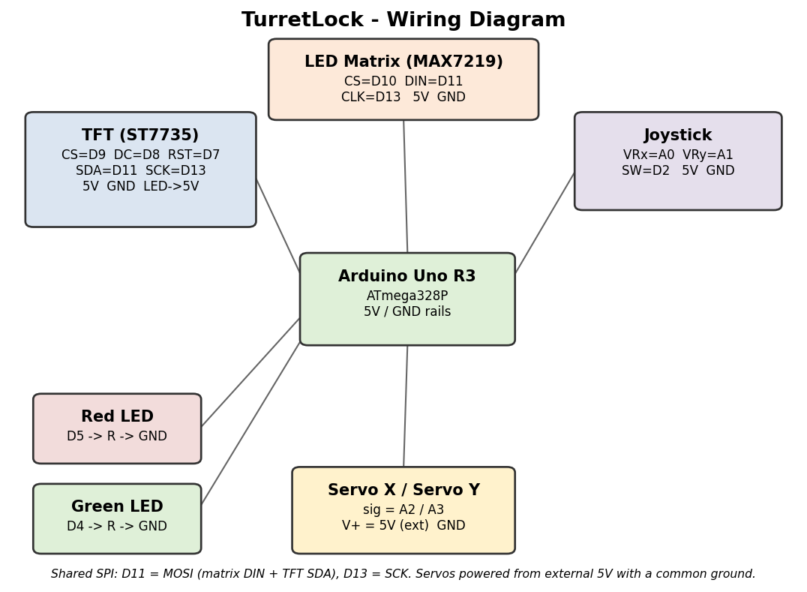
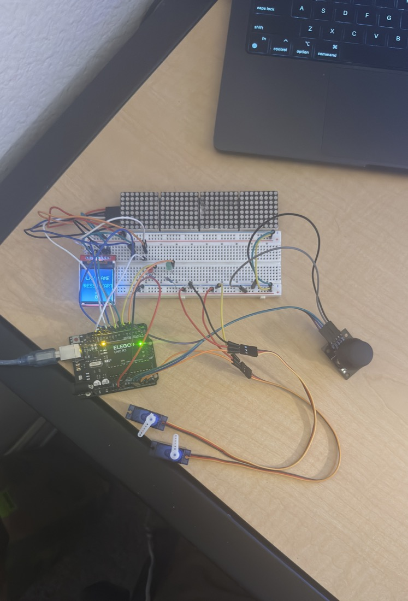
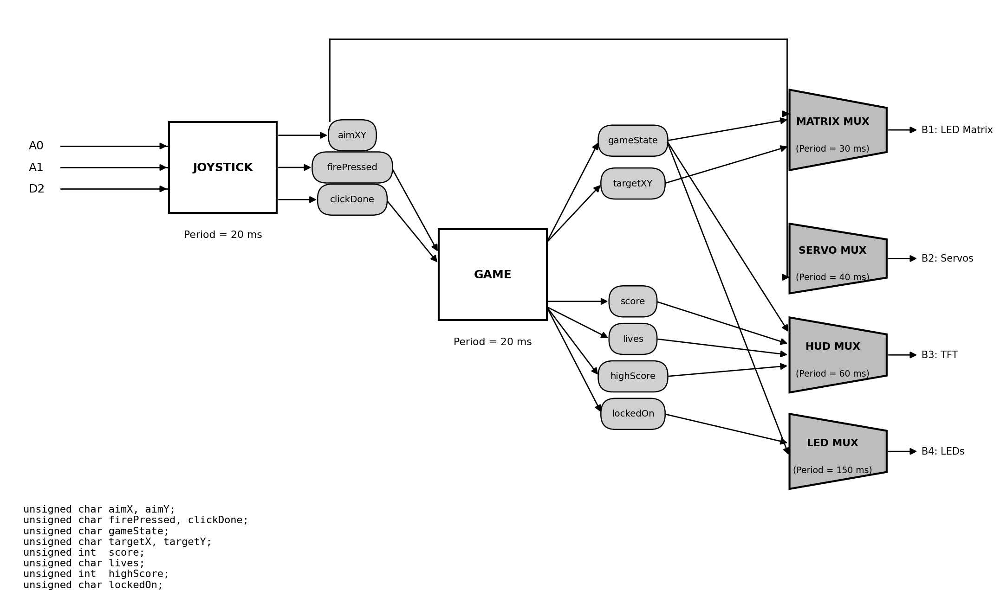
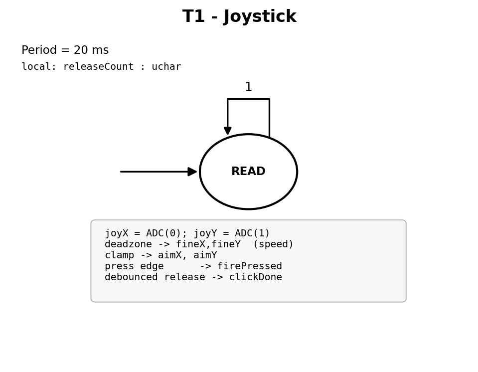
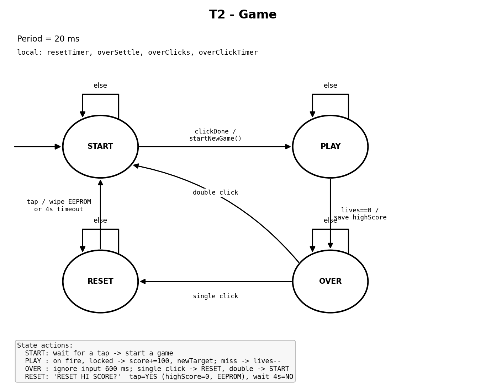
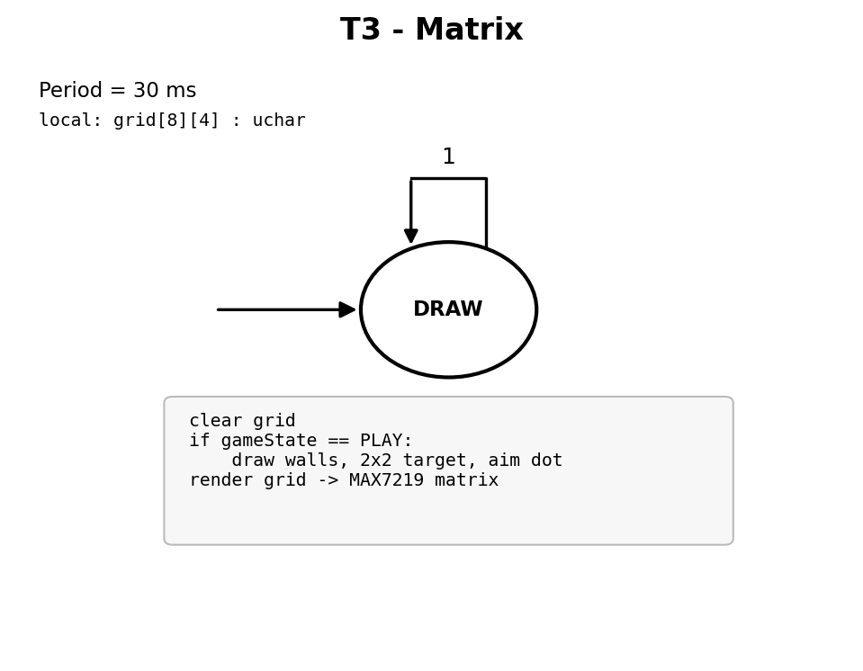
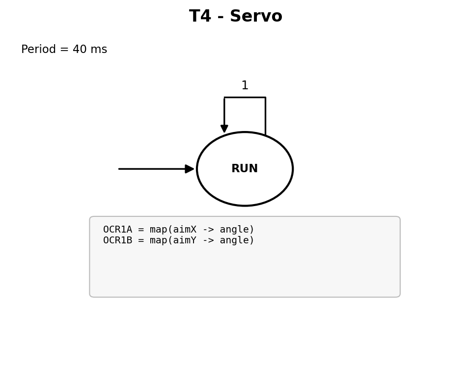
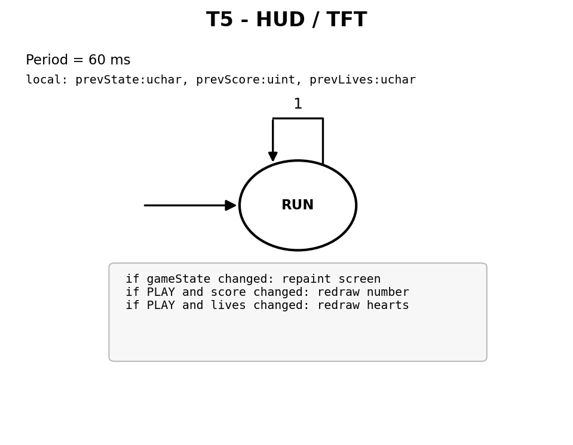
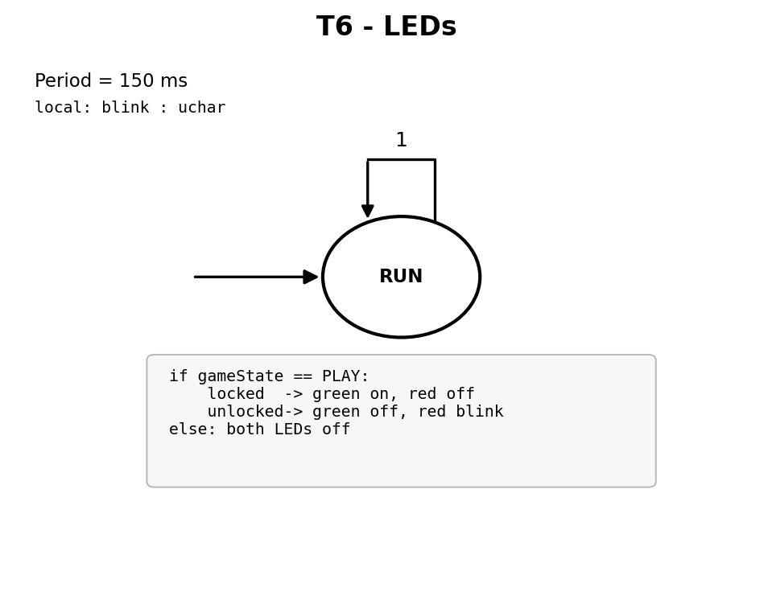

# CS/EE 120B Custom Laboratory Project Report

**Project Title:** TurretLock
**Name:** Pranae Harirajan
**Submission Date:** _<fill in>_

---

## Introduction

TurretLock is a real-time targeting game. A 4-in-1 LED matrix (32x8 pixels) is the
playfield: solid walls sit on the far-left and far-right four columns, and a small
2x2 "target" appears in the open space between them. The player moves a single aim
dot with an analog joystick and tries to line it up with the target. When the dot
is touching the target, a green LED lights to show a lock; otherwise a red LED
blinks. Pressing the joystick button fires: a shot on the target scores 100 points
and spawns a new target, while a shot taken off-target costs one life. A pair of
servo motors act as a physical turret that swings to follow the aim.

The player starts with five lives. Targets are endless, so the score can grow
without limit. When all five lives are lost, the game ends and the screen shows
the final score together with the all-time high score, which is stored in EEPROM
and survives power cycles. A small color TFT screen acts as a heads-up display for
the score, the remaining lives (drawn as heart sprites), and the game messages
(start screen, game over, and a high-score reset prompt).

**Successfully completed:** full core gameplay, two-axis servo turret, lock LEDs,
score, five-life system with heart sprites, endless targets, EEPROM high score,
start / game-over / reset screens, and a click-to-reset gesture for the high
score. The whole program is built as Concurrent SynchSMs driven by a task
scheduler.

**Known limitations:** the joystick is spring-loaded, so the aim is velocity-based
(push to glide, release to hold) rather than absolute.

---

## Elements of Complexity

- **EEPROM-backed high score (implemented).** The all-time high score is read from
  EEPROM at power-up and written back whenever it is beaten, so it persists across
  power cycles. A single click on the game-over screen opens a confirmation
  prompt to wipe it.
- **Custom bare-metal ST7735 TFT driver, no libraries (implemented).** A hand-written
  driver brings up the color TFT (reset, sleep-out, gamma, 16-bit color) and draws
  filled rectangles, a 5x7 text font, centered text, and a heart sprite. It shares
  the SPI data/clock lines with the LED matrix using separate chip-select lines.
- **Custom bare-metal MAX7219 matrix driver (implemented).** A hand-written,
  bit-banged driver drives the four daisy-chained 8x8 panels and periodically
  re-sends the configuration registers so a panel glitched by electrical noise
  self-heals.
- **Two-axis servo turret (implemented).** Two servos track the aim in X and Y,
  driven by Timer1 in the background so motion stays smooth while the game runs.
- **Click-to-reset gesture (implemented).** On the game-over screen, a single click
  opens a confirmation prompt to safely reset the high score; a double click starts a new game.

---

## User Guide

**Controls**
- **Joystick (X/Y):** moves the aim dot on the matrix. The stick is a speed control
  - push to move the dot, release to leave it in place.
- **Joystick button - single click:**
  - on the *Start* screen: begins a game.
  - during *play*: fires at the current aim position.
  - on the *Game Over* screen: opens the "Reset High Score?" prompt.
  - on the *Reset* prompt: confirms wiping the high score.
- **Joystick button - double click** (Game Over screen): starts a new game.

**Visual / physical outputs**
- **LED matrix:** the playfield - walls, the 2x2 target, and the aim dot.
- **TFT screen:** start screen, live score and hearts (lives) during play, and the
  game-over / reset screens.
- **Red LED:** blinks while a target is not yet locked. **Green LED:** solid while
  the aim is on the target.
- **Servos:** swing to match the aim, like a turret.

**Normal flow:** power on -> Start screen (shows the saved high score) -> click to
play -> score by hitting targets, lose a life on each miss -> at 0 lives the
Game Over screen shows the final and high scores -> click to return to Start.

---

## Hardware Components Used

- Arduino Uno R3 (ATmega328P microcontroller)
- MAX7219-based 4-in-1 8x8 LED matrix module (32x8 playfield)
- ST7735 1.44" SPI color TFT LCD (128x128)
- Analog joystick module (X, Y, and push-button)
- 2x hobby servo motors (turret X and Y)
- 2x LEDs (red, green) with current-limiting resistors (220 ohm)
- Breadboard, jumper wires, and a separate 5V supply for the servos (common ground)

---

## Software Libraries Used

No external/third-party libraries were used. Only standard AVR-libc / toolchain
headers:

- **avr/io.h** - register and pin definitions for the ATmega328P.
- **avr/interrupt.h** - the ISR() macro and interrupt control, used for the Timer1
  servo pulses and the Timer2 scheduler tick.
- **avr/eeprom.h** - `eeprom_read_word` / `eeprom_update_word` to persist the high
  score.
- **util/delay.h** - short blocking delays used only in the TFT power-on sequence.
- **avr/pgmspace.h** - stores the font and heart bitmaps in flash (PROGMEM) to save
  RAM.

All peripheral drivers (LED matrix, TFT, ADC/joystick) were written from scratch.

---

## Wiring Diagram

Pin map (Arduino Uno):

| Pin       | Connected to                         | Dir |
|-----------|--------------------------------------|-----|
| A0 / A1   | Joystick VRx / VRy                   | In  |
| A2 / A3   | Servo X / Servo Y signal             | Out |
| D2        | Joystick button (SW), internal pull-up | In |
| D4 / D5   | Green LED / Red LED (via resistor)   | Out |
| D7        | TFT RST                              | Out |
| D8        | TFT DC                               | Out |
| D9        | TFT CS                               | Out |
| D10       | MAX7219 CS                           | Out |
| D11       | MAX7219 DIN + TFT SDA (shared MOSI)  | Out |
| D13       | MAX7219 CLK + TFT SCK (shared clock) | Out |

Power: 5V and GND from the Uno feed the matrix, TFT, joystick, and LEDs; the two
servos use a separate 5V supply with its ground tied to the common ground.

---

## Task Diagram

Scheduler: a Timer2 compare interrupt sets a flag every 1 ms (the GCD). The main
loop runs the task list when the flag is set; each task ticks at its own period.
The two servos are generated independently by Timer1 in the background.

---

## SynchSM Diagrams

One SynchSM per task. Each shows the period, local variables, states, the initial
transition, self-loops (the "stay" condition), and the state actions.

